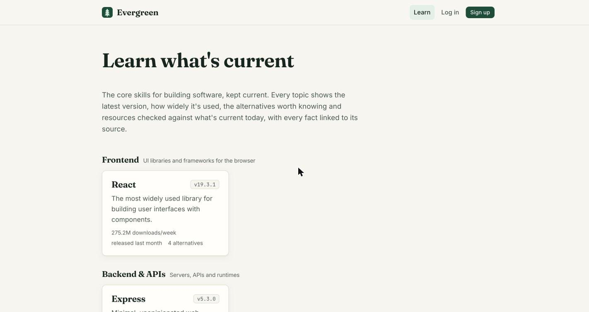
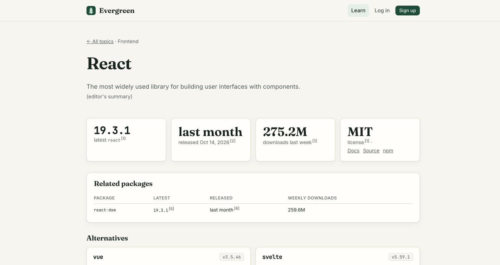
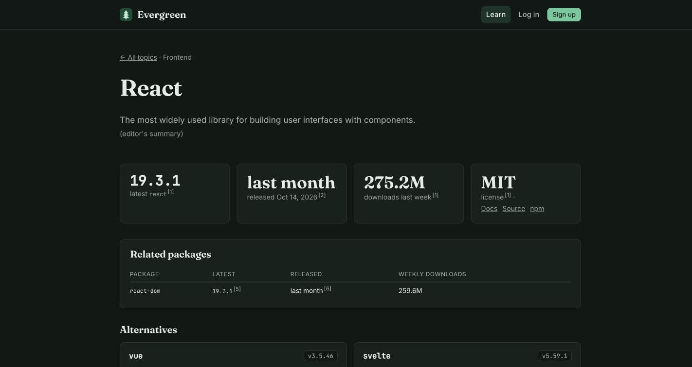
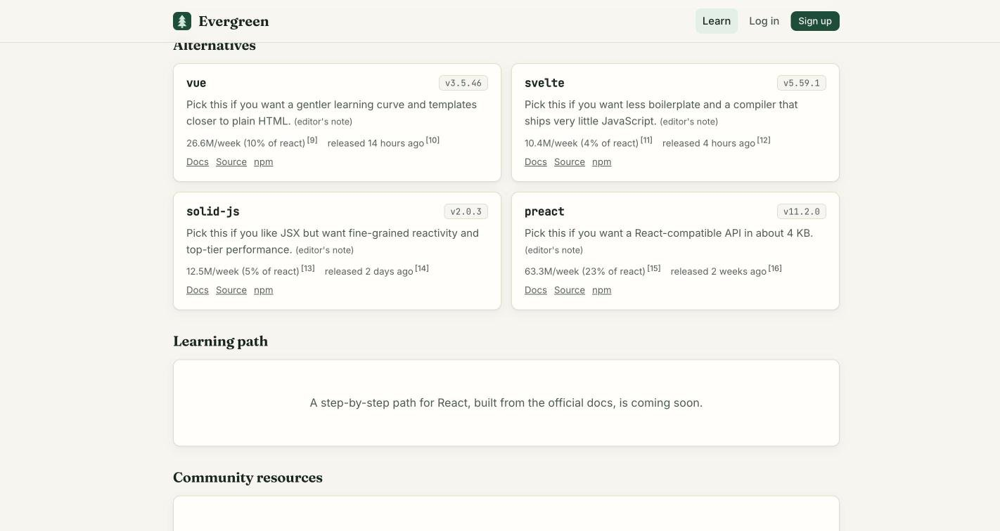
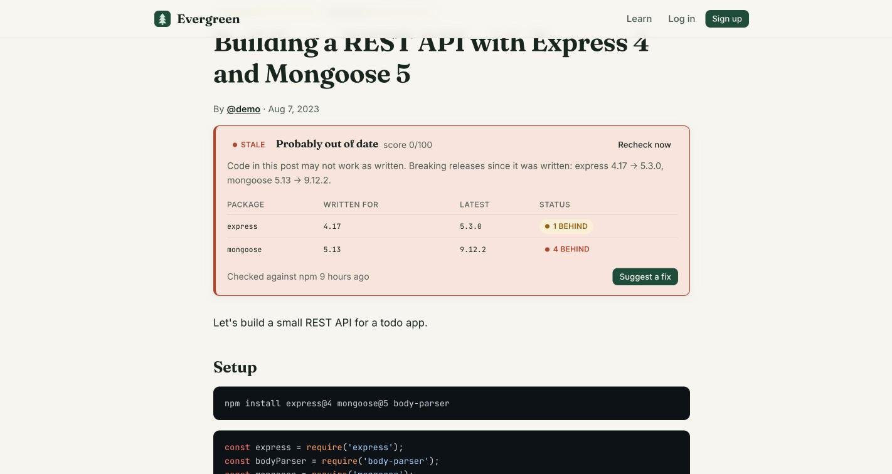
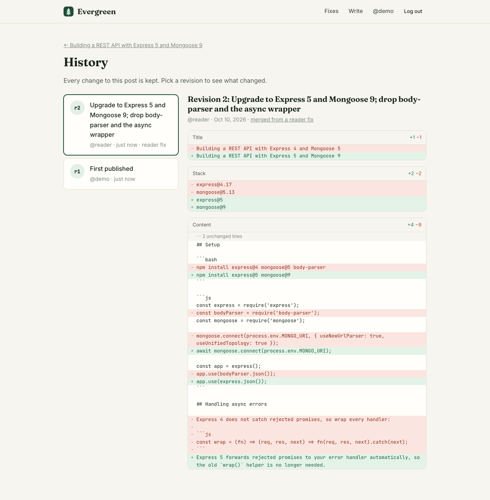
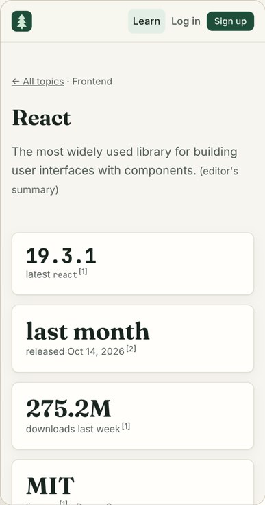
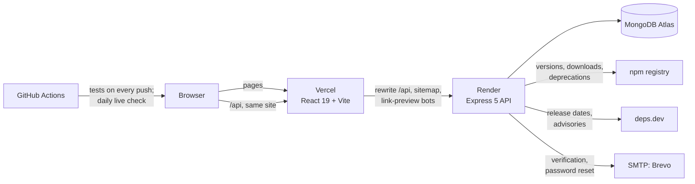

# 🌲 Evergreen

**Learn what's current.** Evergreen is a learning site for the core skills of building software. Every topic shows the latest version, the alternatives worth knowing, a step-by-step learning path built from the official docs, and tutorials checked against what's current today, with every fact linked to its source.

**Live:** [evergreen-indol.vercel.app](https://evergreen-indol.vercel.app) · [](https://github.com/dhiru-7411/evergreen/actions/workflows/ci.yml) [](https://github.com/dhiru-7411/evergreen/actions/workflows/live-check.yml)

> The first visit can take up to a minute while the free-tier API server wakes up.



## Why

Programming tutorials quietly go out of date. A guide written for React 16 or Express 4 still ranks on search engines years later, and learners only find out when the code breaks. Evergreen makes "is this still current?" the first thing you see:

- **Live facts, cited.** Versions, release dates, downloads, licenses, deprecation notices and security advisories come straight from npm and [deps.dev](https://deps.dev), refreshed automatically, and each number links to its source.
- **Paths built from official docs.** Each topic's learning path cites only official documentation pages, and every link is opened and checked before it can be published.
- **Tutorials scored for freshness.** Every post declares the packages it uses and is scored **fresh**, **aging** or **stale** against the latest releases, with exactly which packages drifted.

## Features

**Learn by topic**
- Topics in 8 core areas: frontend, backend, full-stack, databases, languages & tooling, testing, mobile, and AI apps
- Live package data with numbered citations; editor-written text labelled as such
- Alternatives with "pick this if…" notes and how their usage compares
- Learning paths: ordered steps with goals, prerequisites, time estimates and "what changed recently" notes that warn against outdated tutorials; an "outdated" banner appears when a new major version ships

**Tutorials that stay honest**
- Freshness scoring against npm, re-checked by a background job
- Posts are versioned like code: every edit is a revision with a note and a line-by-line diff
- Readers propose fixes, like pull requests for prose; authors review the diff and merge, and contributors are credited

**Community, with checks**
- Suggest a resource: the server opens the page, rejects dead links, off-topic pages and duplicates, detects which major version it teaches, then an editor reviews it
- Request a topic and upvote others; duplicates and topics that already exist are caught
- Report problems with published resources, which sends them back to review

**Accounts**
- httpOnly cookie sessions with refresh-token rotation and stolen-token detection
- Email verification, password reset and change, a list of signed-in devices, and log out everywhere

| Topic page | Dark mode |
| --- | --- |
|  |  |

| Alternatives with sources | A stale tutorial |
| --- | --- |
|  |  |

| Reviewing a reader's fix | Revision history | On a phone |
| --- | --- | --- |
|  |  |  |

## How it works



The browser only ever talks to the site's own address. Vercel forwards `/api` to the Render API, which keeps login cookies first-party (no third-party-cookie problems) and makes cross-site request forgery much harder.

## Engineering highlights

| Problem | Approach |
| --- | --- |
| **Is a tutorial still current?** | Each package gets "breaking releases behind" (majors, or minors for `0.x`): 0 → fresh, 1 → aging, 2+ → stale. A post is only as current as its most outdated dependency, and content not revised for 12 or 24 months loses points. Pure, unit-tested functions in [`server/services/freshness.js`](server/services/freshness.js). The job resolves all packages across all due posts in one batched, cached pass, so 500 posts that mention `react` cost one registry request. |
| **Two people edit at once** | Edits and merged fixes use compare-and-swap on the revision number; if someone saved first, nothing is written and the API returns **409 Conflict**, like a git merge conflict ([`revisions.js`](server/services/revisions.js)). |
| **Fetching user-submitted URLs safely** | Server-side fetching is protected against SSRF: private, loopback and cloud-metadata addresses are blocked inside the socket's DNS lookup (no DNS-rebinding window), redirects are re-validated, and size and time are capped ([`safeFetch.js`](server/services/safeFetch.js)). |
| **Is a page relevant, and which version does it teach?** | Word-bounded topic matching (generic names like `sdk` ignored) and version extraction from text like `react@18`, `Next.js 15`, `v19` ([`resourceChecker.js`](server/services/resourceChecker.js)). |
| **Made-up documentation links** | Every learning-path source is opened before import. Some docs sites answer HTTP 200 for missing pages, so the importer first requests a fake URL in the same folder and rejects pages that look like that "not found" page ([`importPath.js`](server/scripts/importPath.js)). |
| **Stolen login tokens** | 15-minute access tokens plus 30-day refresh tokens in httpOnly, Secure, SameSite cookies; refresh tokens are stored hashed and rotate on every use, and replaying an old one revokes the session ([`sessions.js`](server/services/sessions.js)). |
| **Link previews from a single-page app** | Preview bots don't run JavaScript, so Vercel routes LinkedIn, Slack, WhatsApp, X and Discord to `/api/og`, which renders HTML-escaped Open Graph tags from the database ([`pageMeta.js`](server/services/pageMeta.js)). |
| **Accessibility** | Audited with axe-core (WCAG 2.2 AA) on 17 pages in both themes at desktop and phone width: 0 violations. Skip link, keyboard-scrollable code, 24px tap targets. |
| **Staying online on free tiers** | A daily GitHub Actions check loads the site and its API, keeping the database from being paused for inactivity, and emails the owner if anything is down. |

## Tech stack

| Layer | Tools |
| --- | --- |
| Frontend | React 19, React Router 7, Vite 8, react-markdown + highlight.js, jsdiff |
| Backend | Node 24, Express 5, Mongoose 9, zod, bcrypt, jsonwebtoken, helmet, express-rate-limit, nodemailer, semver |
| Data sources | npm registry and downloads API, deps.dev |
| Testing | `node:test`, supertest, mongodb-memory-server (100 API and unit tests); axe-core for accessibility |
| Hosting | Vercel (site), Render (API), MongoDB Atlas (database), Brevo (email) |
| CI | GitHub Actions: tests, lint and build on every push; daily live-site check |

## Running locally

Requires Node 22+ and a MongoDB connection string (a free [MongoDB Atlas](https://www.mongodb.com/atlas) cluster works).

```bash
npm run install:all

cp server/.env.example server/.env    # fill in MONGO_URI and JWT_SECRET
cp client/.env.example client/.env    # nothing to fill in; the dev server proxies /api

npm run seed          # demo topics, posts and accounts (refuses to run in production)
npm run dev:server    # http://localhost:5001
npm run dev:client    # http://localhost:5173

npm test              # API and unit tests against an in-memory MongoDB
```

After seeding, sign in locally as `demo@evergreen.dev` (admin) or `reader@evergreen.dev`, both with password `evergreen-demo`. These accounts exist only in local databases.

Useful scripts (run in `server/`):

| Command | What it does |
| --- | --- |
| `npm run make-admin -- <username>` | Lets a user manage topics, review resources and publish learning paths (`--revoke` to undo) |
| `npm run import-path -- <slug>` or `-- --all` | Imports learning paths from `content/paths/*.json` as drafts, opening every source link first |
| `npm run migrate` | Upgrades older data (revision history, readable post URLs) |

Without email settings, verification and reset emails are printed to the server log and email verification isn't enforced. Learning paths can optionally be drafted with the Claude API (`ANTHROPIC_API_KEY`); without a key the site works fully and paths are written by hand in `content/paths/`.

## Deploying

| Piece | Where | Config |
| --- | --- | --- |
| API | [Render](https://render.com) Blueprint | [`render.yaml`](render.yaml) (free plan). Set `MONGO_URI`, `CLIENT_URL` (the site's address) and optionally the `SMTP_*` and `MAIL_FROM` email settings; `JWT_SECRET` is generated. |
| Site | [Vercel](https://vercel.com), root directory `client/` | [`client/vercel.json`](client/vercel.json) forwards `/api`, `/sitemap.xml`, `/robots.txt` and link-preview bots to the API host. No environment variables needed. |
| Database | MongoDB Atlas free tier | Allow `0.0.0.0/0` (Render's free instances have no fixed IP); the password still protects it. |
| Email | Any SMTP provider, e.g. Brevo's free tier | `SMTP_HOST`, `SMTP_PORT`, `SMTP_USER`, `SMTP_PASS`, `MAIL_FROM` on the API |

See [docs/API.md](docs/API.md) for every endpoint and [docs/ROADMAP.md](docs/ROADMAP.md) for what's next.
