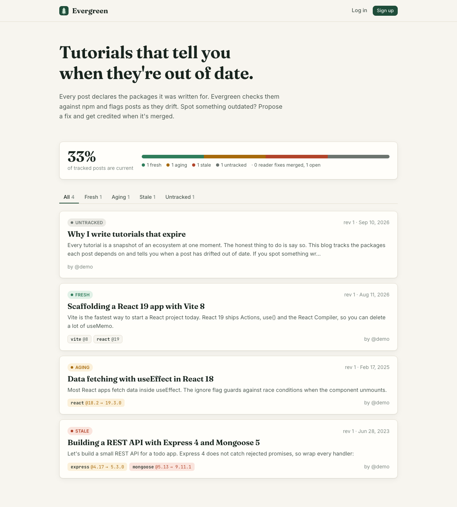
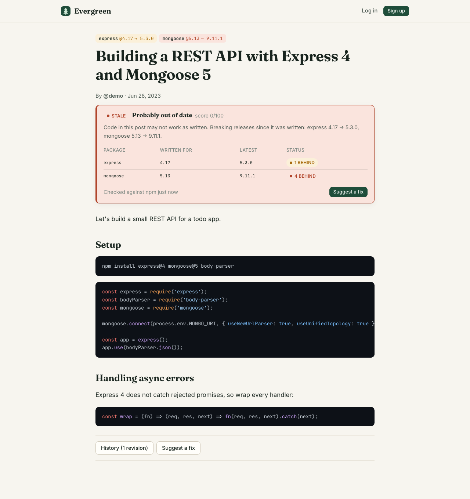
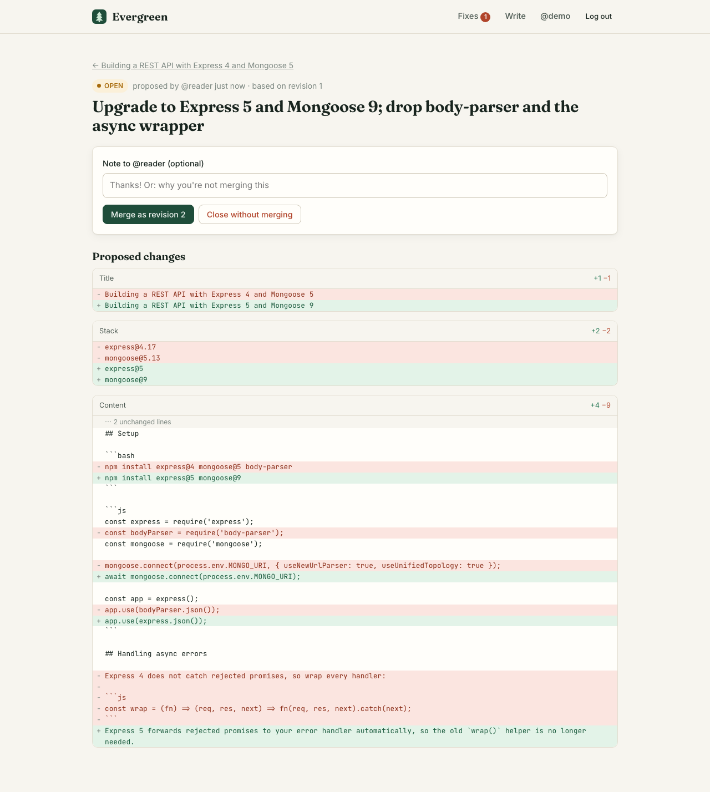
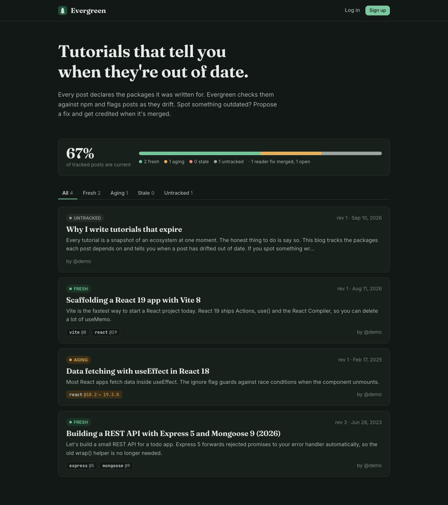
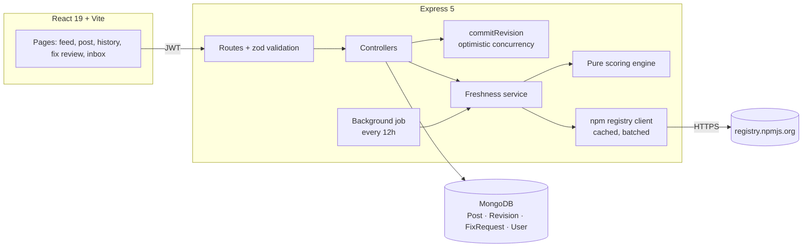

# 🌲 Evergreen

**A developer blog that knows when its tutorials go stale.**

Most programming tutorials quietly rot. A post written for React 16 or Express 4 still ranks on Google years later, and readers only find out it's outdated after the code breaks. Evergreen makes that visible:

- **Every post declares its stack.** For example `express@4.17` and `mongoose@5.13`.
- **A freshness engine checks npm.** A background job compares each post's stack with the latest published versions and scores it **fresh**, **aging** or **stale**, with exactly which packages drifted and by how much.
- **Posts are versioned like code.** Every edit is an immutable revision with a change note and a line-by-line diff.
- **Readers can send fixes.** Spot an outdated post? Propose a change, which works like a pull request for prose. The author reviews the diff, merges it, and you're credited as a contributor.
- **Learn by topic, with sources.** Evergreen covers the core areas of building software (frontend, backend, full-stack, databases, languages & tooling, testing, mobile, AI apps). Each topic page (`/learn/react`) shows the latest version, release date, weekly downloads, license, deprecation notices and known security advisories, live from npm and [deps.dev](https://deps.dev). Every number carries a numbered citation to its source, and editorial notes are labelled as such.
- **Community resources, checked.** Anyone with an account can suggest a tutorial, video or doc. The server opens the page (with SSRF protection) and rejects dead links, pages that aren't about the topic and duplicates; it detects which major version the page teaches and flags outdated ones. A reviewer then checks accuracy before it's published, credited to both people. Readers can report a published resource, which sends it back to review.
- **Search and profiles.** Search by title, text or package name (`react`, `mongoose`…). Every author has a public profile at `/u/:username` with their average freshness score and fixes merged into other people's posts.



| Stale post with freshness report | Reviewing a reader's fix |
| --- | --- |
|  |  |

| Revision history | Dark mode |
| --- | --- |
|  |  |

## How it works



### Freshness scoring

Each package gets "breaking releases behind" (major versions, or minor versions for `0.x` packages, where semver treats minors as breaking):

| Behind | Package score | Status |
| --- | --- | --- |
| 0 | 100 | fresh |
| 1 | 60 | aging |
| 2 | 20 | stale |
| 3+ | 0 | stale |

A post is only as current as its **most outdated** dependency. Content not revised for 12 or 24 months loses another 10 or 20 points. Overall: ≥ 80 fresh, ≥ 50 aging, otherwise stale. Posts with no declared stack are **untracked**. The logic lives in [`server/services/freshness.js`](server/services/freshness.js): pure functions, unit-tested.

The job resolves every package across all due posts in **one batched pass** with an in-memory TTL cache, so 500 posts that mention `react` cost one registry request, not 500.

### Revisions and conflicts

Edits and merged fixes go through [`commitRevision`](server/services/revisions.js), which updates the post with a compare-and-swap on the revision number:

```js
Post.findOneAndUpdate({ _id, revision: baseRevision }, { $set: changes, $inc: { revision: 1 } })
```

If someone else saved first, nothing is written and the API returns **409 Conflict**, the same idea as a git merge conflict. A fix proposed against an older revision is flagged as outdated, and the author can still choose to merge it anyway.

## Tech stack

| Layer | Tools |
| --- | --- |
| Frontend | React 19, React Router 7, Vite, react-markdown + highlight.js, jsdiff |
| Backend | Node 24, Express 5, Mongoose 9, zod, JWT + bcrypt, helmet, express-rate-limit, semver |
| Testing | `node:test`, supertest, mongodb-memory-server (25 API + unit tests) |
| CI | GitHub Actions: server tests, client lint + build |

## Running locally

Requires Node 20+ and a MongoDB connection string (a free [MongoDB Atlas](https://www.mongodb.com/atlas) cluster works).

```bash
npm run install:all

cp server/.env.example server/.env    # fill in MONGO_URI and JWT_SECRET
cp client/.env.example client/.env    # nothing to fill in; the dev server proxies /api

npm run seed          # optional: demo posts with mixed freshness + an open fix
npm run dev:server    # http://localhost:5001
npm run dev:client    # http://localhost:5173
```

Demo logins after seeding: `demo@evergreen.dev` (author and admin) and `reader@evergreen.dev` (reader), both with password `evergreen-demo`.

Only admins can create or delete topics. Promote an account with `npm run make-admin --prefix server -- <username>` (add `--revoke` to undo).

Upgrading a database from the original MERN blog? Run `npm run migrate` once. It backfills revision history for existing posts.

```bash
npm test              # API + unit tests against an in-memory MongoDB
```

## Deploying

| Piece | Where | Config |
| --- | --- | --- |
| API | [Render](https://render.com) (Blueprint) | [`render.yaml`](render.yaml): set `MONGO_URI` and `CLIENT_URL`; `JWT_SECRET` is generated |
| Client | [Vercel](https://vercel.com) or Netlify, root `client/` | Replace `YOUR-API.onrender.com` in [`client/vercel.json`](client/vercel.json) (or [`client/public/_redirects`](client/public/_redirects)) with your API's host. The site calls `/api` on its own domain and the host forwards it to Render, so login cookies are first-party. Leave `VITE_API_URL` unset. |
| Link previews | Vercel only | `client/vercel.json` sends link-preview bots (LinkedIn, Slack, WhatsApp, X, Discord...) to `/api/og`, which returns the page's title, description and image. Netlify can't route by user agent, so previews there show the site defaults. Set `APP_URL` on the API to your public site address. |
| Database | MongoDB Atlas free tier | Allow Render's outbound IPs (or `0.0.0.0/0` for a demo) |

After the first deploy, run `npm run seed` locally with `MONGO_URI` pointed at Atlas to load the demo posts.

## API

| Method | Endpoint | Auth | Description |
| --- | --- | --- | --- |
| POST | `/api/auth/register` · `/api/auth/login` | | Get a JWT |
| GET | `/api/auth/me` | ✓ | Current user |
| GET | `/api/posts?page&limit&status&author&q` | | Paginated feed; filter by freshness, author or search text |
| GET | `/api/posts/stats` | | Freshness breakdown across the blog |
| POST | `/api/posts` | ✓ | Create (revision 1) |
| GET | `/api/posts/:id` | | Post + contributors + open fix count |
| PATCH | `/api/posts/:id` | author | New revision; needs `note` and `baseRevision` |
| DELETE | `/api/posts/:id` | author | Deletes post, revisions and fixes |
| POST | `/api/posts/:id/freshness` | ✓ | Re-check against npm now |
| GET | `/api/posts/:id/revisions[/:number]` | | History / one snapshot |
| GET · POST | `/api/posts/:id/fixes` | POST ✓ | List / propose a fix |
| GET | `/api/fixes/inbox` · `/api/fixes/mine` | ✓ | Fixes to review / fixes you proposed |
| GET | `/api/fixes/:id` | | Fix + base revision for diffing |
| POST | `/api/fixes/:id/merge` · `/reject` | author | Review a fix |
| GET | `/api/users/:username` | | Public profile: post counts by freshness, average score, merged fixes |
| GET | `/api/topics` | | All topics with live data for their main package |
| GET | `/api/topics/:slug` | | Topic page: live package data, alternatives, related posts (refreshes if older than 6h) |
| POST | `/api/topics` | admin | Create from a name, npm packages and alternatives |
| DELETE | `/api/topics/:slug` | admin | Remove a topic and its resources |
| GET | `/api/topics/categories` | | The knowledge areas Evergreen covers |
| POST | `/api/topics/:slug/resources` | ✓ | Suggest a resource; runs reachability, relevance, duplicate and version checks |
| GET | `/api/resources/review` | admin | Pending resources and reported ones |
| POST | `/api/resources/:id/approve` · `/reject` | admin | Review a resource (optional `reviewNote`) |
| POST | `/api/resources/:id/report` | ✓ | Report a problem with a published resource |

## Roadmap

See [docs/ROADMAP.md](docs/ROADMAP.md).
